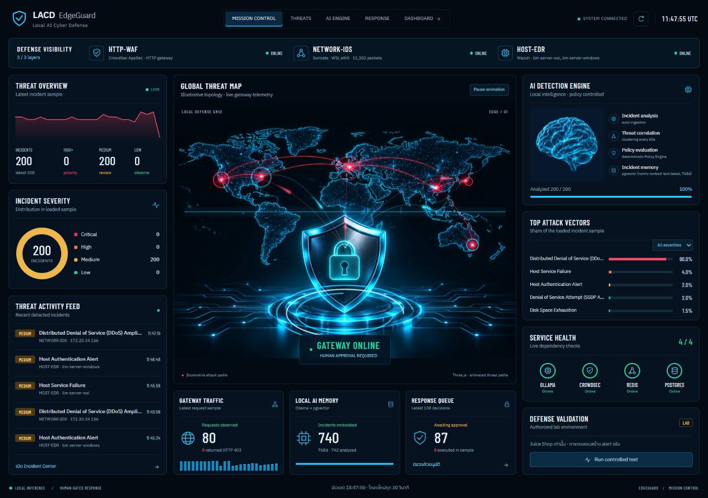
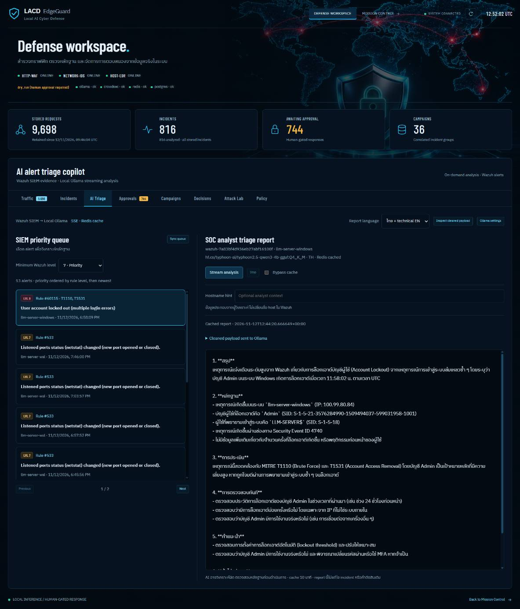
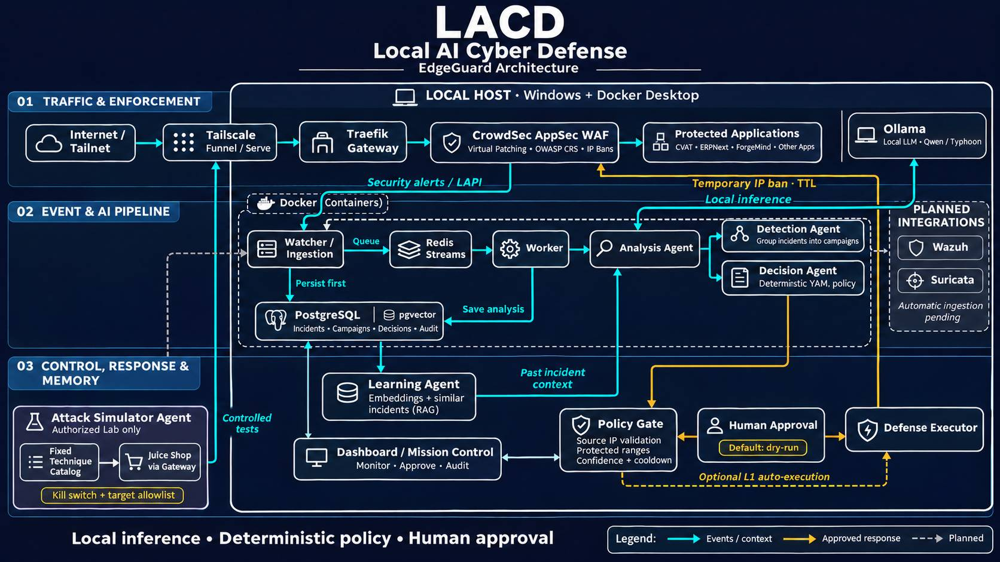

# Local AI EdgeGuard

ระบบป้องกันเว็บและวิเคราะห์เหตุการณ์ด้วย AI ภายในเครื่อง: Traefik + CrowdSec ทำงานด่านหน้า ส่วน Ollama วิเคราะห์หลักฐานและเสนอการตอบสนองผ่าน Policy Engine

## ภาพตัวอย่าง

### Mission Control — มุมมองการป้องกัน 3 ชั้น



### Dashboard — AI Alert Triage Copilot



ภาพหน้าจอเป็นตัวอย่าง ณ เวลาที่บันทึก ตัวเลขและสถานะอาจต่างจากระบบปัจจุบัน ดูรายละเอียดได้ที่ [Mission Control](docs/mission-control.md) และ [AI Triage](docs/ai-triage.md)

### Architecture — ภาพอ้างอิงรุ่นก่อน



ภาพ Architecture นี้จัดทำก่อนเชื่อม Wazuh และ Suricata จึงยังแสดงทั้งสองส่วนเป็น Planned Integrations ปัจจุบันเชื่อมใช้งานแล้วตามขอบเขตใน [สถานะระบบ](docs/current-status.md) ใช้ภาพนี้ประกอบความเข้าใจภาพรวม โดยยึดเอกสารและโค้ดปัจจุบันเป็นหลัก

## สถาปัตยกรรมปัจจุบัน

```text
Internet / Tailscale → Traefik → CrowdSec AppSec / OWASP CRS → แอปปลายทาง
                                     │ alerts
                                     ↓
                         watcher → PostgreSQL → Redis Streams
                                                      ↓
                                         worker → Ollama Analysis
                                                      ↓
                         Detection (campaigns) + Decision (YAML policy)
                                                      ↓
                                   Human approval / L1 auto-execution
                                                      ↓
                                         Defense → CrowdSec IP ban

Analyzed incidents → Ollama embeddings → pgvector → บริบทสำหรับเหตุการณ์ถัดไป
```

LLM ไม่อยู่ในเส้นทางรอรับ HTTP request และไม่สั่งบล็อกโดยตรง Learning ใช้ RAG จากเหตุการณ์เก่า ไม่ได้ฝึกโมเดลใหม่

## ส่วนประกอบ

| ตำแหน่ง | หน้าที่ |
|---|---|
| `edge-guard/` | Gateway: Traefik, CrowdSec WAF, PostgreSQL/pgvector |
| `edge-ai/` | FastAPI, watcher/worker, 6 Agent roles, Dashboard/Mission |
| `lab/` | Juice Shop และ attacker ที่ใช้รายการเทคนิคตายตัว |
| `wazuh/` | Wazuh Manager + Windows/Ubuntu agents; ส่ง host alerts เข้า edge-ai แล้ว |
| `pilot/MIGRATION.md` | วิธีผูกแอปเข้ากับ gateway ทีละ route |
| `tools/` | ทดสอบ routing/false positives, ดู WAF log, จัดการ firewall |

## สถานะและ deployment

- โค้ดมี ingestion, analysis, campaigns, policy/approval, defense, Attack Lab, pgvector และ UI แล้ว
- Gateway ที่เครื่องนี้ใช้ config จาก `C:\Docker\gateway\` โดย repo เป็นแหล่งต้นฉบับ แก้และตรวจใน repo ก่อน sync ไป live
- edge-ai ใช้ compose ที่ `edge-ai/` และเชื่อม gateway network `gateway_gateway_net` กับ `edge_web`
- ค่าเริ่มต้น `DEFENSE_AUTO_EXECUTE=false`: ต้องอนุมัติการตอบสนอง ส่วน `ATTACK_ENABLED=false` ปิดการทดสอบ Lab
- API โดยตรงเปิดเฉพาะ `127.0.0.1:8099`; ทาง Tailnet ต้องผ่าน gateway ที่มี WAF + Basic Auth
- หน้า Mission ใหม่พร้อมภาพ 3D/Three.js และสถานะ HTTP-WAF + Network-IDS + Host-EDR: [docs/mission-control.md](docs/mission-control.md)
- เอกสารผลตรวจรอบก่อนและข้อจำกัด: [docs/current-status.md](docs/current-status.md)
- ประวัติ migration และผลทดสอบก่อนหน้า: [docs/gateway-migration.md](docs/gateway-migration.md)

หน้าใช้งานบนเครื่อง:

- Dashboard: `http://127.0.0.1:8099/dashboard`
- Mission: `http://127.0.0.1:8099/mission`
- Health: `http://127.0.0.1:8099/health`
- API docs: `http://127.0.0.1:8099/docs`

ทาง Tailnet ใช้ `https://llm-server.tail923b9a.ts.net:8443/AIEdgeGuard/mission` หรือ alias `/aiedge/mission` ผ่าน gateway ที่ตั้งค่าไว้แล้ว

## กติกาการตอบสนอง

- Policy อนุญาตอัตโนมัติเฉพาะ `temporary_ip_block` ตามชนิดเหตุการณ์, confidence และ severity ที่กำหนด
- IP เป้าหมายต้องตรงกับ source IP ของเหตุการณ์ ข้อเสนอ IP อื่นจะถูกปฏิเสธ
- IP ภายใน, Tailscale, loopback และ IPv6 ภายในต้องให้คนอนุมัติ
- `needs_human_review` หรือ `prompt_injection_suspected` ห้ามทำอัตโนมัติ
- บล็อกเริ่มต้น 15 นาที สูงสุดตาม policy 1 ชั่วโมง และมี cooldown 30 นาทีจากเวลาที่ execute สำเร็จ
- คำขออนุมัติและปฏิเสธเปลี่ยนสถานะแบบ atomic ป้องกันการ execute ซ้ำ
- ถ้าคำตอบจาก enforcement หาย สถานะเป็น `execution_unknown` ต้องตรวจ CrowdSec ก่อนตัดสินใจต่อ

## การพัฒนาและทดสอบ

```powershell
uv venv .venv
uv pip install --python .venv/Scripts/python.exe -r edge-ai/api/requirements.txt
.venv/Scripts/python.exe -m unittest discover -s edge-ai/api/tests -v
```

ชุดทดสอบไม่ส่งคำสั่งบล็อกจริง ตั้ง `EDGEGUARD_TEST_DATABASE_URL` ให้เป็น PostgreSQL ทดสอบแยก ชื่อฐานข้อมูล `edgeguard_test` เพื่อรัน integration tests ครบ ชุด integration จะล้างข้อมูลในฐานทดสอบนี้ทุกกรณี

ทดสอบ Mission ด้วย Playwright + Chrome ที่ติดตั้งแล้ว:

```powershell
python edge-ai/api/tests/verify_mission.py
python edge-ai/api/tests/verify_dashboard.py
python edge-ai/api/tests/verify_triage.py
```

สคริปต์จำลอง API ทั้งหมด ไม่ยิงโจมตีจริง และเก็บภาพที่ `.artifacts/`

Dashboard ใหม่รองรับ responsive 3D, server paging, ค้นหา/กรองข้อมูล และเปิดดู request headers หรือ packet/payload ที่ sensor บันทึกไว้ พร้อม export JSON ดูข้อจำกัดการเก็บข้อมูลและวิธีตั้งค่าได้ที่ [Dashboard](docs/dashboard.md) (ภาพทดสอบ Dashboard อยู่ที่ `.impeccable/review/`)

แท็บ [AI Triage Copilot](docs/ai-triage.md) เลือก Wazuh alert แล้วสตรีมบทวิเคราะห์ภาษาไทย/อังกฤษจาก Ollama พร้อมดู cleaned payload, เลือกโมเดลที่ติดตั้ง, hostname hint และ Redis cache/bypass โดยไม่แก้ไขคำตัดสินเดิม

ตรวจ compose โดยไม่แสดง secrets:

```powershell
docker compose -f edge-ai/docker-compose.yml config --quiet
docker compose --env-file C:/Docker/gateway/.env -f edge-guard/docker-compose.yml config --quiet
```

Compose gateway ผูกกับ network และไฟล์ของแอปอื่นบนเครื่องนี้ การย้ายเครื่องต้องปรับ external networks, host paths, Tailscale IP และ credentials ให้ตรงก่อนใช้งาน `.env` ห้าม commit

## งานต่อยอด

1. ขยาย Network-IDS จาก WSL eth0 ไปยัง Windows/LAN ด้วยการ mirror หรือ routing ที่กำหนดชัดเจน
2. ตรวจ firewall จากเครื่อง Tailnet อีกเครื่อง (การทดสอบจากเครื่องเดียวกันไม่ยืนยัน remote filtering)
3. วัด false positives และประสิทธิภาพจาก traffic จริงก่อนเปิด auto-execution
4. Pin image และ Python dependencies สำหรับ release ที่ทำซ้ำได้

ดูแผนเดิมได้ที่ [feasibility study](docs/feasibility-study.md) และ [reference plan](docs/reference-chatgpt-plan.md) โดยใช้โค้ดและ current-status เป็นหลักเมื่อต่างจาก roadmap เก่า
