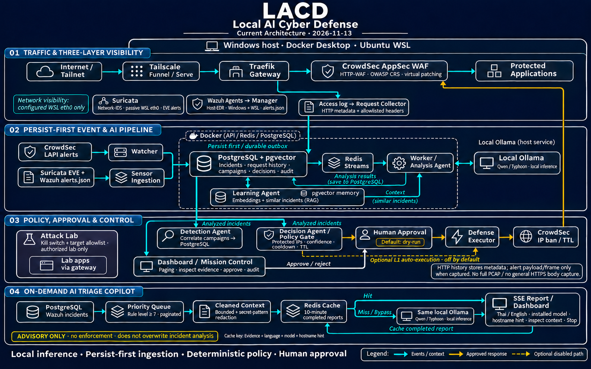

# LACD architecture flow

Current source-aligned diagram, 2026-11-13:

## Traffic and sensors

HTTP requests pass through Tailscale Funnel/Serve, Traefik and CrowdSec AppSec/OWASP CRS before reaching protected applications. Traefik's WAF middleware invokes AppSec; the diagram presents this logical inspection order rather than separate inline network appliances.

Suricata supplies passive Network-IDS evidence from configured Ubuntu WSL `eth0`. Wazuh Windows/WSL agents supply Host-EDR evidence through their Manager. Both ingestion integrations exist; they are no longer planned. This is not a guarantee of current sensor uptime or full host/LAN network coverage. Mission uses live status endpoints separately.

Traefik access logs follow an independent request-collector branch into PostgreSQL history. This stores HTTP metadata and allowlisted headers, not general request bodies or full PCAP. Payload/packet evidence is available on sensor alert events only when captured; encrypted HTTPS bodies are not generally visible to the passive sensor.

## Persist-first incident processing

- CrowdSec LAPI alerts → Watcher → PostgreSQL incidents.
- Suricata EVE and Wazuh Manager alert files → Sensor Ingestion → PostgreSQL incidents.
- PostgreSQL durable outbox → Redis Streams → Worker/Analysis Agent ↔ host Ollama; analysis results are written back to PostgreSQL.
- Detection and Decision are separate consumers of analyzed incidents. Detection correlates campaigns; Decision applies deterministic policy. Detection is not a prerequisite stage feeding Decision.
- Learning embeds analyzed incidents through Ollama and stores pgvector memory. Similar-incident context feeds analysis; this is retrieval, not model training.

The picture groups API/Redis/PostgreSQL within the Docker boundary. Ollama is the existing host service; Windows agents are not Docker containers. Repeated storage/Ollama references in the Triage lane denote the same existing services.

## Approval and enforcement

Policy checks include protected IPs, confidence, cooldown and TTL. Default dry-run behavior proposes a response for human approval. Dashboard approval/rejection goes through the stored-decision workflow; an approved action is executed by the restricted Defense Executor, which applies a CrowdSec IP ban with a TTL. Optional policy-approved L1 auto-execution is configurable and off by default. Neither the analysis model nor the Triage copilot directly calls enforcement.

Dashboard/Mission read persisted evidence, status and response records. The Attack Lab sends controlled traffic to authorized lab apps through the gateway, guarded by a kill switch and target allowlist. Its compact card uses text instead of a long crossing connector.

## On-demand AI Triage

Dashboard selects a retained Wazuh incident from a paginated priority queue (default rule level ≥7), builds bounded/redacted context, and checks Redis. A hit returns the completed cached report through SSE. A miss or bypass calls local Ollama, streams the report, and caches only a completed result for 10 minutes. Cache keys incorporate evidence, language, model and hostname hint, plus the prompt version. Thai/English, installed-model selection, an optional unverified hostname hint, context inspection and Stop are available.

This branch is advisory. It does not overwrite stored incident analysis, create decisions or execute defense. The image's arrows summarize these logical paths; queue retries, status heartbeats and individual SQL operations are omitted for readability.

## Sources and image provenance

- [Sensor ingestion](../edge-ai/api/app/telemetry.py), [Watcher/outbox publisher](../edge-ai/api/app/watcher.py), [Worker](../edge-ai/api/app/worker.py).
- [Request collector](../edge-ai/api/app/traffic.py), [Decision agent](../edge-ai/api/app/agents/decider.py), [Triage API](../edge-ai/api/app/triage.py).
- [Mission scope](mission-control.md), [Dashboard/history limits](dashboard.md), [AI Triage behavior](ai-triage.md).
- [Full imagegen prompt set](assets/examples/architecture-current.prompt.md). The image was generated with the built-in imagegen tool and corrected for connector direction before publication.

The earlier [architecture reference](assets/examples/architecture-reference.jpg) remains historical and still labels the sensors as planned. Use the current image above for the current implemented flow.
